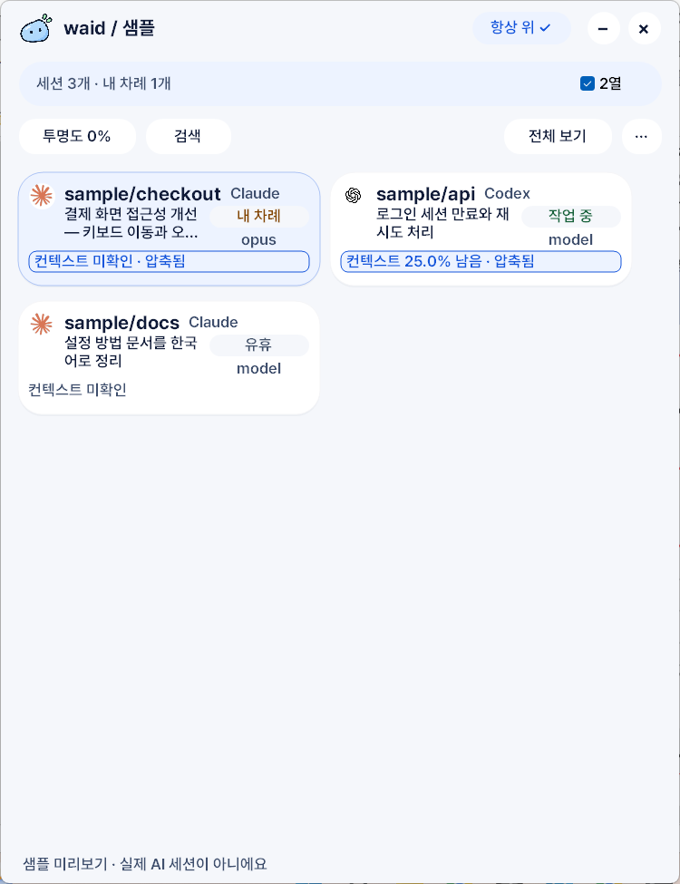
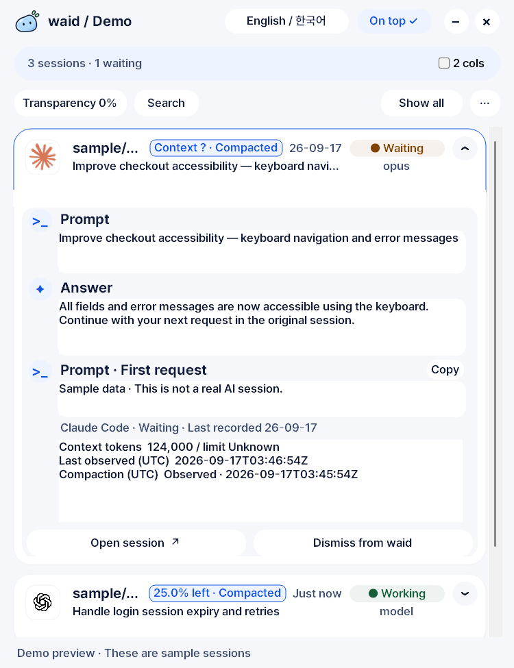

<p align="center">
  <picture>
    <source media="(prefers-color-scheme: dark)" srcset="assets/waid-on-dark.png">
    
  </picture>
</p>

<h1 align="center">waid — what am I doing?</h1>

<p align="center">
  Keep track of your <b>Orca</b>, <b>Claude Code</b>, and <b>Codex</b> sessions in one small window.<br>
  Native Windows app. Single EXE. Session data stays on your PC. No telemetry or cloud sync.
</p>

<p align="center">
  <a href="https://github.com/laekhole/what-am-i-doing/releases/latest"><b>Download for Windows</b></a> ·
  <a href="#화면으로-보는-사용법">화면으로 보는 사용법</a> ·
  <a href="#why">English overview</a> ·
  <a href="docs/USER_GUIDE.md">User guide</a> ·
  <a href="README.ko.md">한국어</a>
</p>

<p align="center">
  
</p>

## 화면으로 보는 사용법

Claude Code에는 결제 화면을, Codex에는 로그인 API를, 다른 세션에는 문서 정리를 맡겼다고 해볼게요. 잠깐 다른 일을 하고 돌아와 **“내가 뭐하고 있었지?”** 싶을 때, waid에서 하던 작업과 마지막 답변을 확인하면 됩니다.

현재 지원 대상은 **Orca, Codex, Claude Code 세 가지**입니다. Orca 안에서 돌리는 Codex·Claude Code 세션도 함께 봅니다. 프로젝트·최근 요청·모델·로그에서 관찰한 상태를 모아 보여주고, 카드를 펼치면 마지막으로 기록된 답변을 읽을 수 있습니다.

**[Windows용 다운로드](https://github.com/laekhole/what-am-i-doing/releases/tag/v0.2.0)** · Windows 10/11 x64 · EXE 하나 · 공개 v0.2.0은 한국어 UI

<table>
  <tr>
    <th>어느 세션부터 볼지 고르기</th>
    <th>요청과 답변 펼치기</th>
  </tr>
  <tr>
    <td width="50%"><a href="assets/screenshots/sessions-ko.png"></a></td>
    <td width="50%"><a href="assets/screenshots/expanded-en.png"></a></td>
  </tr>
  <tr>
    <td>한국어 UI · 샘플 데이터</td>
    <td>최신 소스 빌드의 영어 UI · 샘플 데이터<br>공개 v0.2.0은 한국어 UI입니다.</td>
  </tr>
</table>

위 화면에서는 결제 화면 작업이 **내 차례**, 로그인 API는 **작업 중**, 문서 세션은 **유휴**입니다. 결제 화면 세션부터 펼쳐 답변을 읽고, 원래 도구에서 변경 내용을 검토하거나 다음 요청을 보내면 됩니다. 이미지를 누르면 원본 크기로 볼 수 있습니다.

<details>
<summary><strong>처음 실행부터 세션 정리까지 — 상세 사용법 펼치기</strong></summary>

1. **실행 파일 받기.** [v0.2.0 릴리스](https://github.com/laekhole/what-am-i-doing/releases/tag/v0.2.0)에서 `waid-v0.2.0-windows-x64.exe`를 받아 실행합니다. 설치 프로그램이나 별도 런타임은 필요 없습니다.
2. **원래 도구에서 새 요청 보내기.** waid를 켠 뒤 평소 쓰던 Orca·Codex·Claude Code에서 작업을 시작합니다. waid에 API 키를 넣거나 대화를 복사할 필요는 없습니다.
3. **프로젝트와 상태 확인하기.** 목록은 약 2초마다 갱신됩니다. 시작 전에 진행하던 대화는 처음에 `미확인`일 수 있습니다. 새 요청·답변이 로그에 기록되면 상태가 갱신되며, 기록이 늦으면 표시도 늦습니다.
4. **카드 펼치기.** `2열`을 해제하고 카드 제목 부분을 누릅니다. 최근 요청과 마지막으로 기록된 답변을 읽고, 다음 지시는 원래 에이전트에서 보냅니다.
5. **세션 정리하기.** 자주 보는 세션은 고정하고 검색·필터로 작업을 찾습니다. 당분간 안 볼 세션은 숨기고, 끝난 대화는 `waid에서 보지 않기`로 정리합니다. 원래 대화가 지워지거나 에이전트가 종료되지는 않습니다.

**세션이 안 보일 때:** 검색어와 필터를 지우고 `전체 보기`를 확인하세요. 서브에이전트는 `보조 포함`도 켜보세요. 그래도 없다면 도구 이름·운영체제·새 요청을 보낸 뒤의 상태를 [이슈](https://github.com/laekhole/what-am-i-doing/issues)로 알려주세요.

**Orca로 돌아가기:** 현재 실행과 일치하는 로컬 세션은 에이전트 로고나 `세션 열기`로 돌아갈 수 있습니다. 실행 가능한 Orca CLI와 현재 연결 정보가 필요합니다. 모든 터미널 탭으로 자동 이동하거나 SSH 세션으로 복귀하는 기능은 아닙니다.

</details>

<details>
<summary><strong>클론해서 고쳐 쓰기 · 다른 툴 추가 요청하기</strong></summary>

MIT 라이선스로 공개했습니다. 저장소를 클론해 카드 배치, 필터, 로그 수집 방식을 본인 일하는 방식에 맞게 고도화해 쓰셔도 됩니다.

```sh
git clone https://github.com/laekhole/what-am-i-doing.git
```

수정한 소스를 실행하려면 아래 [빌드 방법](#build-from-source)을 참고하세요. 단순히 사용하려면 EXE만 받으면 됩니다.

**추가했으면 하는 툴은 [GitHub 이슈](https://github.com/laekhole/what-am-i-doing/issues/new)로 요청해주세요.** 로그 구조와 연동 방법을 확인해 추가하겠습니다. 도구 이름, 운영체제, 한눈에 보고 싶은 정보를 적어주시면 도움이 됩니다. 개인 대화나 인증정보가 담긴 원본 로그는 공개하지 않아도 됩니다.

</details>

로그와 대화 내용은 PC 안에서 처리하며 외부로 전송하지 않습니다. EXE는 아직 Windows 코드 서명(Authenticode)이 없어 SmartScreen이나 Smart App Control에서 실행이 차단될 수 있습니다. macOS 앱은 개발 중입니다.

<p align="center">
  <br>
  <b>내 차례부터 보자.</b>
</p>

디자인과 움직이는 마스코트가 있는 [HTML 원본](docs/geeknews-preview.html)도 함께 있습니다. GitHub에서는 소스로 열리며, 저장소를 클론한 뒤 `docs/geeknews-preview.html`을 브라우저에서 열면 이미지와 글꼴까지 표시됩니다.

## Why

You have five coding agents running in five terminals. One of them finished ten minutes ago and is waiting for you. Which one?

waid answers that without you clicking through every window:

- **Project · latest request · agent · model · status** for every session, refreshed every two seconds.
- **Waiting / Working / Idle / Error** badges help you choose which session to check next.
- **Expand a card** to read the last prompt and answer without switching apps. Copy the prompt in one click.
- **Remaining context** and compaction evidence when the agent logs them, so you know before the session forgets.
- **Search, filter, pin, hide, dismiss.** Return to the original window or Orca session where the integration supports it.

It observes and never intervenes. waid does not launch agents, send prompts, or edit conversations.

The screenshots above use sample data. The English expanded view is from the current source; the published v0.2.0 EXE has a Korean UI. Tray status counts and quiet reply notifications are also current-source features awaiting the next release.

## Install

**Windows 10/11 x64.** Download `waid-<version>-windows-x64.exe` from the [latest release](https://github.com/laekhole/what-am-i-doing/releases/latest) and double-click it. No installer, no runtime, no WebView2. Close hides it to the tray; Exit is in the tray menu.

Two things to know before you download:

- **The published v0.2.0 EXE has a Korean UI.** The English / 한국어 switch, tray status counts, and reply notifications are in the current source and ship with the next release. Until then, [build from source](#build-from-source) for English.
- **The EXE is not Authenticode-signed yet**, so SmartScreen or Smart App Control may block it. Each release carries a SHA-256 checksum and a Sigstore signature from this repository's release workflow. [How to verify.](docs/USER_GUIDE.md#download-and-verify-a-release)

macOS is in development for v0.3.0 (native AppKit, same Rust core). See [MACOS.md](MACOS.md) to build a development copy. Linux can use the CLI today.

## Supported agents

The supported workflows are **Orca, Codex, and Claude Code**. Orca sessions use the underlying Claude Code or Codex logs and available local integration metadata.

| Agent | What waid reads | Confidence |
|---|---|---|
| Claude Code, Codex | JSONL transcripts: requests, answers, model, status, context usage | Verified against real logs |
| Orca | Provider session logs and existing local hook metadata; return to a uniquely matched existing local session | Available in v0.2.0; return needs the Orca CLI and current session mapping. SSH return is unsupported. |

Status is derived from log events. If an agent writes its log late, waid shows the change late. Sessions that were active before waid started show **Unknown** until a new request or response is logged. Full details in the [user guide](docs/USER_GUIDE.md#agent-support).

Other readers remain experimental and are outside the supported workflows above; their individual validation limits are recorded in the [user guide](docs/USER_GUIDE.md#agent-support). To adapt waid to your workflow, fork or clone the MIT-licensed source. Adding a JSON/JSONL source often needs only a [custom adapter](CLI.md#에이전트-추가하기). [Request another tool](https://github.com/laekhole/what-am-i-doing/issues/new) with its name, operating system, and the session information you want to see; the maintainer will examine its log format and add an integration.

## Privacy

- Runs entirely on your machine. No telemetry, analytics, cloud sync, accounts, or API calls.
- Opens agent logs read-only. Never modifies them, never sends prompts to agents.
- Settings and previews live in `%LOCALAPPDATA%\waid\settings.json` (override with `WAID_DATA_DIR`). They can contain prompt and answer text, so treat that file like your logs.
- The optional CLI dashboard binds to `127.0.0.1` only.

Details and the exact limits are in [Privacy and local operation](docs/USER_GUIDE.md#privacy-and-local-operation).

## Status and roadmap

| Version | Milestone | Status |
|---|---|---|
| v0.2.0 | Windows | Released. Stabilization continues. |
| v0.3.0 | macOS | Native app in development, CI on Apple Silicon and Intel |
| v0.4.0 | Android + LAN viewing (waidaway) | Planned |
| v0.5.0 | iOS / iPadOS | Planned |
| v1.0.0 | Stable across supported platforms | Future |

This is an early project by a single maintainer. Bug reports with your Windows version, agent, and the step that failed are the most useful thing you can send. [Open an issue](https://github.com/laekhole/what-am-i-doing/issues).

## CLI

The desktop app is a shell around an independent `waid` binary with zero external crates. It works on Windows, macOS and Linux.

```text
waid                  Print a table once
waid --waiting        Only sessions waiting on you
waid --json --watch   Stream JSON snapshots (schema 2)
waid --html --watch   Local dashboard at http://127.0.0.1:7423
waid doctor           Explain why a session is missing
```

See [CLI.md](CLI.md) for flags, adapters, and themes.

## Build from source

Requires a Rust toolchain and the MSVC build tools (for the icon resource compiler).

```powershell
cargo build --release --locked
cargo build --manifest-path desktop/Cargo.toml --release --locked
.\desktop\target\release\waid-desktop.exe
```

Run `cargo test --release --locked` in both crates before opening a pull request. With Node.js installed, run `node tests/dashboard.cjs` for dashboard refresh checks. `desktop/test-package.ps1` checks Windows package versions, checksums and overwrite protection after building. The GitHub Actions [core and Windows checks](.github/workflows/check.yml) test the Linux core and Windows app; [macOS checks](.github/workflows/macos.yml) cover both Mac architectures. Native build artifacts are unsigned or ad-hoc signed development packages.

## Documentation

- [User guide](docs/USER_GUIDE.md) — every control, status meaning, session-return target, and troubleshooting step.
- [CLI.md](CLI.md) — flags, custom adapters, HTML themes.
- [TEMPLATES.md](TEMPLATES.md) — desktop appearance templates.
- [MACOS.md](MACOS.md) — building and testing the Mac app.
- [VALIDATION.md](VALIDATION.md) — what has been verified on real machines and what has not.
- [SIGNING.md](SIGNING.md) — code-signing status and plan.
- [DECISIONS.md](DECISIONS.md), [MANIFESTO.md](MANIFESTO.md), [HISTORY.md](HISTORY.md) — design rationale and work log (Korean).
- [Release notes](releases/)

## Credits and license

Created and maintained by [laekhole](https://github.com/laekhole), with AI coding assistance from Claude (Claude Code) and GPT (Codex), credited in commit trailers.

MIT License. See [LICENSE](LICENSE) and [THIRD_PARTY_NOTICES.txt](THIRD_PARTY_NOTICES.txt). Bundled Pretendard fonts are under the [SIL Open Font License](desktop/assets/fonts/LICENSE.txt). The OpenAI, Claude and Orca marks shown beside sessions belong to their owners.
